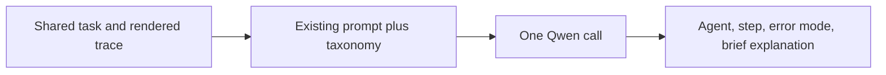
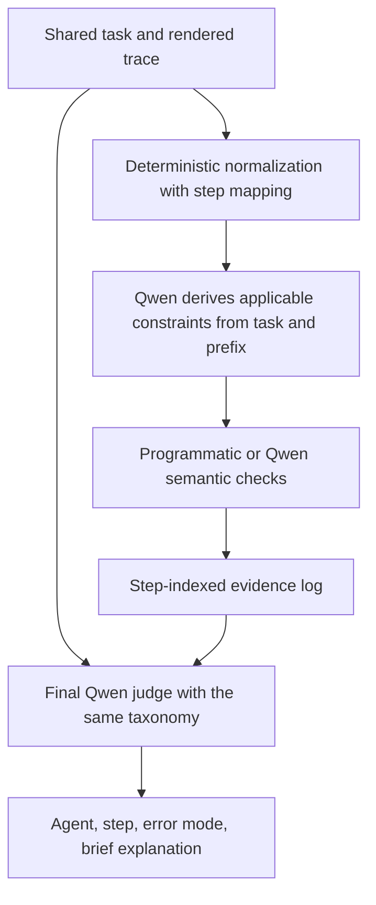
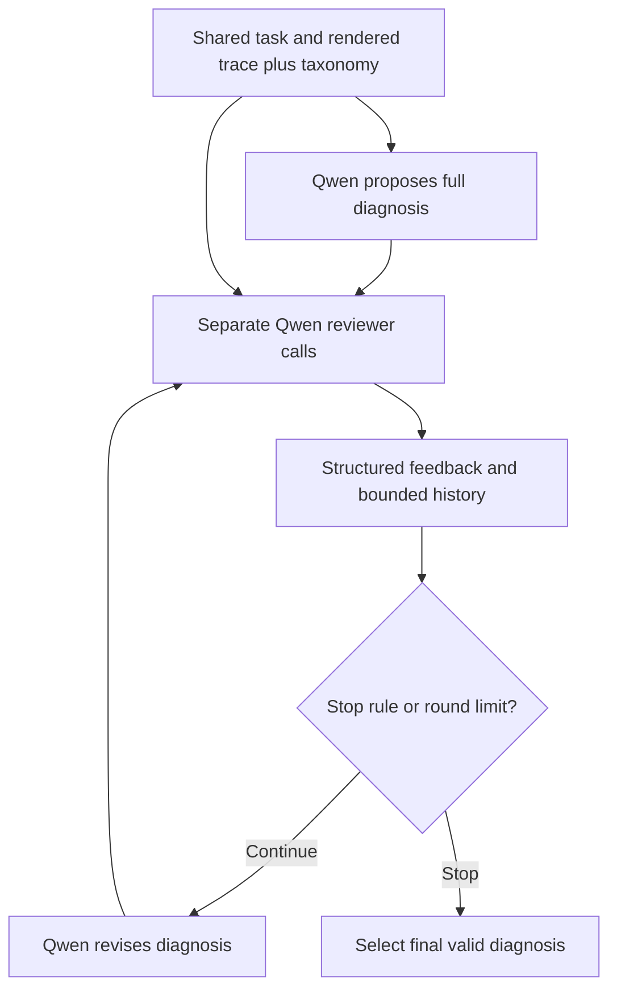

# Who&When Pro: frozen-model judge harness comparison

Status: research specification draft; no experiment has been run. The three-condition comparison and focus on error classification come from the user. Settings explicitly marked **proposed** are drafting choices, not decisions already approved by the user.

## Purpose and scope

Measure how the judge harness changes failure-attribution performance when the underlying Qwen3.5 model is held fixed. The primary outcome is **What: error-mode macro-F1**. Improvement, regression, and no detectable difference are all valid outcomes. Also measure Who, When, All, and resource use.

The user selected a comparison of the existing all-at-once baseline with **both** AgentRx-inspired evidence gathering and RAFFLES-inspired review. These alternatives have different mechanisms: evidence before diagnosis versus diagnosis followed by criticism. They are separate experimental conditions, not a combined pipeline. This document records that comparison; it does not introduce another research hypothesis.

This is a comparison of whole harnesses at their recorded costs. Additional calls and generated context are part of the intervention. It does not isolate orchestration from extra inference compute, reproduce either external paper exactly, repair the original agents, or establish causal truth through environment interventions.

## Conditions and controls

| Role | Setting |
|---|---|
| Independent variable | Judge harness: baseline, AgentRx-inspired, RAFFLES-inspired |
| Frozen model | One exact Qwen3.5 checkpoint, provider/deployment, model configuration, and supported reasoning setting across every LLM role |
| Frozen inputs | Identical task/trace examples, visible source information, modality assets, and native step/agent mappings |
| Frozen evaluation | Same pinned taxonomy, final prediction parser, per-framework scorer, metric aggregation, and cohort |
| Primary outcome | Error-mode macro-F1; paired difference from baseline for each alternative |
| Secondary outcomes | Agent accuracy, step accuracy, joint accuracy, per-mode precision/recall/F1 and confusion matrices |
| Resource outcomes | Calls, input/output tokens, available reasoning-token counts, wall time, monetary cost when known, retries, failures, and budget exhaustion |

Temperature and per-call output limits should be identical across roles where supported; the same setting does not make multi-call harnesses equal-cost. Freeze all role prompts before the evaluation run. Log the effective model settings, not just requested parameters: the existing client can drop unsupported options.

Exact model size/checkpoint, deployment, modality scope, sample size, repetitions, token caps, and monetary ceiling remain **unset**. “Qwen3.5” alone is not a runnable model specification.

## Dataset and information boundary

Pin repository revision, dataset revision, taxonomy contents/hash, sampled IDs, and media preprocessing before running. The code inspected for this draft is revision `2c0d925a224a0a207cdd9669ffed5db911d19abd`.

The availability audit inspected all 6,257 text rows, all 916 video rows, and five examples each from image and GUI splits. Every inspected row contained a nonempty task query and trajectory. Examples include explicit coding specifications, data-analysis requirements, and tool-argument documentation in EVA system messages. This is not evidence that complete policies or schemas are available for every example.

**Proposed primary information boundary:** use exactly the information made visible by the pinned existing baseline renderer/prompt. Build an immutable, sanitized source bundle from those renderable task/trace components. All three conditions receive that same source bundle; only their processing differs. Normalized events must retain original text/media and map back to the existing scorer's coordinates. This deterministic adapter must not add a model-generated summary or infer facts.

This choice matters because, for example, the EVA renderer skips its initial system message, while that raw message can describe tool arguments. The smolagents renderer also skips initial user framing that can contain extra task instructions. Do not silently give such omitted material only to an alternative harness. If richer raw instructions are later included, that is a separately specified information intervention with a corresponding baseline; it is outside this draft's primary comparison.

Keep an evaluation-only sidecar for ground truth. No judge, constraint generator, checker, or reviewer may see attribution labels, accepted-label alternatives, injection/replay flags, injection metadata, reference answers, or post-hoc evaluation results. Raw IDs or filenames that expose error codes must not enter model context. A synthetic bookkeeping ID may remain outside prompts. Preserve ordinary task examples already visible to the baseline; do not treat those as hidden answers.

The release documentation currently describes 17 taxonomy modes while the paper/repository description discussed in the session says 18. Resolve that version discrepancy and pin one authoritative artifact before running; do not silently reconcile or invent a label. All conditions must use the same pinned artifact, and results must identify whether they target the released version or a paper-matched version.

## A. Existing all-at-once baseline

Reuse the existing prompt construction and renderer. Preserve its no-reference-answer condition and exact final output contract. The brief explanation is retained for inspection but is not scored as an additional outcome. Do not add new tools, evidence, reviews, or prompt repair calls to this condition.

## B. AgentRx-inspired evidence harness

1. Normalize the shared source bundle into events with an agent, native/scorer step mapping, recorded content, and media references. A normalized event is an observation, not a correctness label.
2. Generate task-level requirements once, then derive dynamic checks for each judge-visible step from the task and the prefix through that step. Future events are unavailable to this stage. Each constraint records its source, applicability condition, assertion, and scope. A final-outcome requirement must not be applied prematurely to every intermediate step.
3. Route explicit structured comparisons to a small allowlisted checker library: numeric comparisons, required-field presence, membership, equality, and similarly bounded rules. Never execute arbitrary code generated by Qwen or copied from the recorded trace. If extracting the operands required Qwen, record that dependence; deterministic arithmetic does not validate the extraction.
4. Use Qwen for semantic checks that require interpretation. Each applicable check returns satisfied, violated, or inconclusive with source references. Missing observations yield inconclusive, not an invented violation. Constraints may be mistaken; model judgment is not ground truth.
5. Retain the full check audit internally. Give the final judge a bounded evidence log of violations and inconclusive checks, including extraction limitations. Preserve chronological ordering; use a fixed, logged size policy rather than selecting evidence using labels.
6. The final Qwen call sees the same full source bundle, the evidence log, and the pinned taxonomy definitions as its checklist. It predicts all three attribution fields jointly. Evidence is advisory: the judge can reject a violation as recovered, irrelevant, or a downstream symptom.

An event can have zero, one, or multiple applicable checks. This design does not require correctness labels for every step or access to a restorable environment.

### Illustrative evidence record

| Field | Example |
|---|---|
| Target | Travel agent, step 4 |
| Requirement and source | Selected flight costs at most £500; original task |
| Applicability | A flight is selected, rather than merely mentioned |
| Evidence | Step 3 tool observation prices flight A at £620; step 4 selects flight A |
| Check | Compare selected flight's recorded price to task budget |
| Method | Programmatic comparison; record whether operand linking was deterministic or model-derived |
| Result | Violated, £120 above budget |
| Limitation | Does not establish whether this is the decisive fault or determine its error category |

This is a proposed local record, not AgentRx's exact schema. The Pro taxonomy, agent attribution, baseline-visible information restriction, normalization adapter, and evidence limits are adaptations.

## C. RAFFLES-inspired review harness

The initial judge predicts agent, step, error mode, and a short justification. Reviewers independently receive that candidate and the shared full source bundle. They do not receive one another's current-round feedback.

| Reviewer | Question |
|---|---|
| Fault | Is the identified action actually an error given the task and evidence? |
| Decisiveness | Does the evidence support this error as decisive for the observed failure, rather than harmless or recovered? |
| Primacy | Is there an earlier decisive fault the diagnosis missed? |
| Taxonomy — proposed addition | Does the selected Pro error mode fit the cited mistake, rather than a later symptom? |

Each reviewer returns support, challenge, or inconclusive, with cited steps and a brief reason. A deterministic validator checks output shape, agent/step existence and compatibility, and taxonomy membership; it cannot validate the causal explanation.

**Proposed bounded policy:** at most two review cycles. Cycle one reviews the initial candidate. If all four reviewers support it and structural validation succeeds, stop. Otherwise make one revision call using the accumulated feedback, then run cycle two. Return the latest structurally valid candidate; if the revision is malformed, retain the earlier valid candidate and record the fallback. If neither candidate is valid, return an invalid outcome. Persistent disagreement at the cap is logged, not described as consensus. Maximum normal-path calls: two judge calls plus eight reviewer calls, before transport retries.

These votes, the four-reviewer arrangement, stopping rule, and final-candidate policy are **proposed adaptations**. Original RAFFLES uses three semantic criteria, a rule-based consistency component, confidence aggregation, and confidence-based stopping/selection. This condition must be called RAFFLES-inspired, not an exact reproduction. No reviewer actually reruns the failed agent. Multiple roles use the same frozen model and can share correlated errors.

## Execution, isolation, and recording

Create a fixed cohort manifest with the same examples in all conditions. Do not use the runner's first-N-pending selection as if it were random sampling. Any sampling/stratification and development/evaluation separation must be fixed before inspecting treatment outcomes. Related variants of one source task should remain in the same partition when identifiable. Development examples can be used to settle prompts and budgets; hold evaluation examples out of that tuning.

Cache/resume identity must include dataset revision, trace ID, harness version, prompt/configuration hash, model/deployment, and repetition. The existing model/benchmark/trace resume identity is insufficient. Never reuse a baseline prediction as a treatment result or reuse intermediate feedback across traces. A completed run must account for every scheduled condition/trace/repetition.

Record source-bundle hash, normalized-step map, calls, intermediate constraints/checks/reviews, final raw and parsed output, effective settings, usage, latency, retry/fallback status, and error status. Store hidden labels separately from everything supplied to LLM roles. Do not merge successful repetitions into an unregistered ensemble or select the best repetition using labels.

Transport retries must repeat the same request under a fixed policy and be included in resource totals. Schema errors are not transport failures. Do not silently add model repair calls. Context/token overflow must be detected and handled under a pinned policy, not by hidden truncation. Input-capacity exclusions must be established in shared preflight, applied to every condition before the cohort is frozen, and reported by reason. Overflow caused by generated evidence or review history after that point is a condition failure on the fixed cohort, not a reason to remove the example.

An empty constraint set is a valid evidence-stage result: the final judge receives no generated violations. A malformed or failed intermediate call is not equivalent to an empty result. **Proposed failure policy:** after permitted transport retries, a failed required generator/checker/reviewer call makes that condition's run invalid; preserve the partial audit and do not silently continue with less evidence or fewer reviewers. The explicit malformed-revision fallback in the RAFFLES condition is the exception described above. A well-formed inconclusive check or review remains a valid result.

## Scoring and reporting

Use the pinned implementation's coordinate conversions and accepted-label behavior. Step correctness is framework-specific; do not replace it with a universal one-step tolerance.

| Metric | Existing definition to preserve |
|---|---|
| Who | Agent correctness, averaged within each multi-agent framework and then across those frameworks |
| When | Step correctness, averaged within each framework and then across frameworks |
| What | Macro-F1 over canonical error modes with nonzero gold support in the modality/cohort |
| All | All three per-axis correctness flags true on the same trace, then averaged per framework |

The per-axis scorer accepts alternate labels independently; its joint result does not enforce one coherent alternate tuple. The macro-F1 implementation uses canonical gold modes, not that alternate-label logic. Preserve and document this distinction. Composite scores average modalities equally, over a fixed declared set shared by every condition. A subset's scores are not full-benchmark reproduction numbers.

**Proposed failure accounting:** primary results retain every scheduled example in the fixed eligible cohort. An unusable final output receives false correctness on all axes and an invalid mode prediction, producing a false negative for its gold mode. Valid output fields are scored normally using the shared parser/scorer. The existing leaderboard skips error records, so implement the fixed-denominator report alongside a clearly labeled upstream-compatible successful-record report; do not present the latter alone. Record completion and invalid-output rates.

For both alternatives, report paired differences from baseline, including negative differences. **Proposed uncertainty analysis:** paired bootstrap intervals that resample the same examples/groups across all conditions, stratified by the fixed modality/framework structure, with related source-task variants clustered when identifiable. Recompute the actual aggregation per sample and retain the original cohort's supported class set for macro-F1. With repetitions, report per-repetition scores and variation; do not treat repeats of one trace as independent tasks. Specify the final resampling and multiple-comparison convention before the evaluation run.

The results table should contain each condition's four metrics, changes in primary F1, uncertainty, completion rate, calls/tokens, latency, and cost. Include per-mode counts so rare-class changes are visible. No improvement is a valid finding. Better label agreement is not proof that the harness recovered a unique causal explanation.

## Decisions needed before execution

These do not block writing or reviewing this specification. They must be resolved before paid model calls or a claimed preregistered evaluation:

- Exact Qwen3.5 checkpoint/deployment and supported modalities/settings.
- Dataset/taxonomy revision, including the documented 17-versus-18-mode discrepancy.
- Modality scope, cohort size, development/evaluation partition, sampling seed and grouping.
- Repeat count, per-call/context/constraint/evidence limits, total cost cap, concurrency, and retry/overflow policy.
- Acceptance or revision of the proposed taxonomy reviewer, two-cycle review policy, failure accounting, and uncertainty reporting.

The builder may choose internal module organization, serialization, and scheduling details, provided they preserve this information boundary, output/scoring contract, bounded execution, and auditable records. Those choices cannot silently resolve the experimental settings above.

## Acceptance criteria for a later implementation

- Baseline prompt/media output matches the pinned original on representative frameworks.
- Every arm receives identical source information; label/injection metadata is excluded from all LLM inputs.
- Normalized events and evidence references map correctly to the native/scorer step coordinates, including grouped turns.
- Programmatic and semantic checks distinguish violated, satisfied, and inconclusive; absent evidence is not fabricated.
- RAFFLES stopping, disagreement, malformed-candidate fallback, and call bounds behave as specified.
- Scoring matches existing behavior on valid records; fixed-denominator failures and framework weighting are verified explicitly.
- Runs resume without mixing conditions/repetitions, and every scheduled example has a result or recorded failure.

No execution, dependency installation, environment intervention, or author outreach is authorized by this documentation task alone.

## Sources

- [Who&When Pro repository](https://github.com/VasPug/whowhen_pro), especially `run.py`, `prompts.py`, renderers, `score.py`, `leaderboard.py`, and `store.py` at the pinned revision.
- [Released dataset and schema](https://huggingface.co/datasets/Leoxx/whowhen_pro).
- [Who&When Pro paper](https://arxiv.org/abs/2607.09996).
- [AgentRx paper, version 2](https://arxiv.org/abs/2602.02475v2) and [official implementation](https://github.com/microsoft/AgentRx).
- [RAFFLES, EACL 2026](https://aclanthology.org/2026.eacl-long.359/).
- [Princeton: Emerging Trends in AI Agent Evaluation](https://sage.cs.princeton.edu/trends/emerging-trends-paper.pdf), for separating model/scaffold effects, documenting budgets, and reporting uncertainty.
